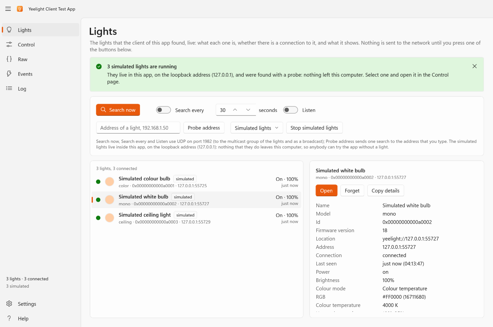
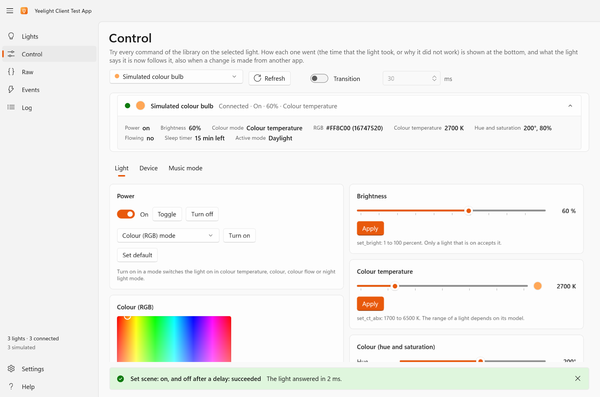
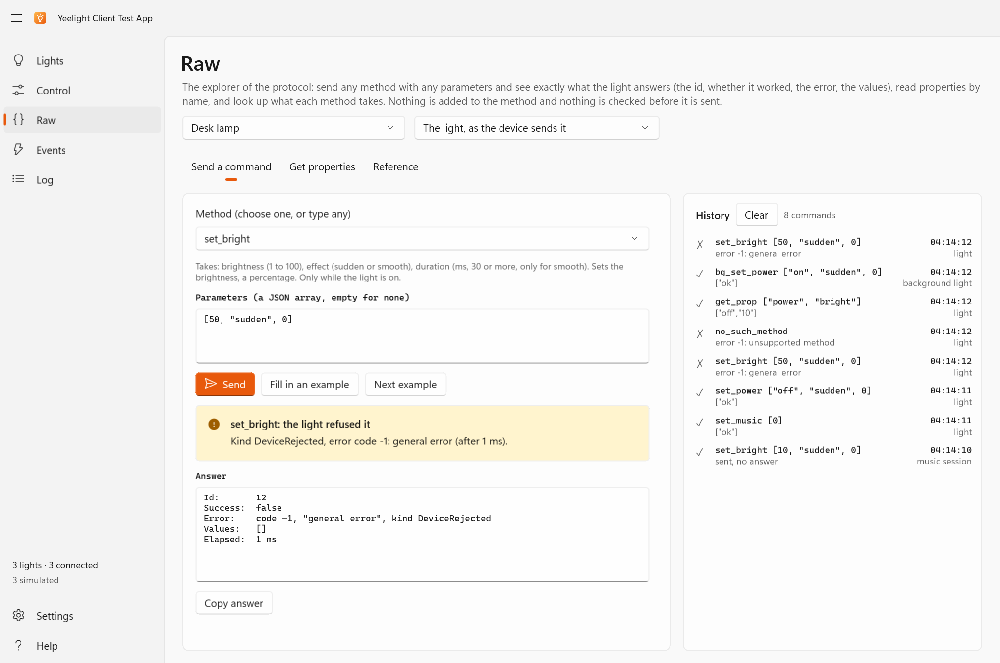

# The test app

`YeelightClient.TestApp` is a Windows application (WinUI 3, Fluent 2) to **try every command and event of the library by hand**, against your own
lights or against lights that it simulates. It is made for human testing and trials: it lets you see what a command does, what the light says
back and what the client makes of it, before you write any code. It only uses the public API of the library, and it is not part of the NuGet
package.

## Get it

Every [release](https://github.com/tinodo/yeelightclient/releases) has the app as a download: under *Assets*, take
**`YeelightClient.TestApp-<version>-win-x64.zip`**, unzip it, and start `YeelightClient.TestApp.exe`. The app is self-contained, so nothing else has
to be installed. It is built for Windows 10 version 1809 and later, and the download is for x64.

> [!NOTE]
> The app is not code signed, so Windows may warn that the publisher is unknown. The notes of each release list the SHA-256 of the zip and say how
> to check where the files were built from.

The newest build of the `main` branch is also published as the artifact **`YeelightClient.TestApp-win-x64`** of the
[Build and Test workflow](https://github.com/tinodo/yeelightclient/actions/workflows/build.yml): open the newest successful run on `main`, and
download the artifact (GitHub asks you to sign in to download artifacts, and keeps them for two weeks).

To build and run it from the source you need Windows and the .NET 10 SDK:

```shell
dotnet run --project YeelightClient.TestApp -p:Platform=x64
```

## Nothing is sent until you start a search

The app sends nothing to the network when it starts. It finds lights when you ask it to: **Search now**, **Search every** so many seconds, **Listen**
to the announcements or **Probe address**, all on the Lights page. After that it talks to the lights that it found, over the one connection that the
library keeps for each, with the same limit of commands as any program that uses the library.

## Try it without a light

The Lights page can start **simulated lights**, all three at once or one by one from its **Simulated lights** button: a colour bulb, a white bulb that
can only be dimmed (it lists no colour methods, so you can see what the library does with a command that a light does not support), and a ceiling
light with a background light. They run inside the app, on the loopback, and the app finds them with a probe. Nothing that they do leaves the
computer, and no real light is asked or answered. They answer the way the specification says, with a state that the commands change, reports of every
change, the commands that only a light that is on accepts, a quota on every connection and music mode, so the whole library can be tried with them.

## The pages

The pages are in the navigation pane on the left. **Ctrl+1** to **Ctrl+6** open the first six in that order, and **F1** opens Help.

| Page | What it does |
| --- | --- |
| **Lights** | The lights of the client, live: name, model, address, whether they are connected, on or off, brightness and colour. Search now (**F5**), search every so many seconds, listen to announcements, probe one address, start simulated lights. Select a light to see what it lists, open it on the Control page, or forget it. |
| **Control** | Every command of a light: power, brightness, colour temperature, RGB and HSV, adjusting, scenes, a colour flow editor, the sleep timer, the name, connecting and disconnecting, the background light, and music mode (with a rainbow demo). The outcome of every command, or the exception that it threw, is shown, and the state follows the light. |
| **Raw** | Any command, by its method and its parameters as JSON, with the answer of the light and how long it took, and a reference of the methods of the protocol. |
| **Events** | Every event as the client raises it. |
| **Log** | Everything that the client logs, the messages that went over the wire included. Export it as JSON lines. |
| **Settings** | The options of the client (a change is applied by making a new client, which clears the list of lights), the theme, and the folder of the exports. |
| **Help** | What the app is for, the versions of the app, the library and the runtime, how to switch on LAN Control, links to this documentation, the repository and the package, and the keyboard shortcuts. |

What you see on the Control page is what the library makes of a command: an argument that a light would refuse is refused before anything is sent,
a method that the light does not list is not sent, and the outcome says which of the failures of the library it was: see
[Errors and limits](errors-and-limits.md). The Raw page sends exactly what you type, which is how to find out what a light does with something that
the library does not do.

The Lights page, with three simulated lights:



The Control page, with a light selected: its state follows what it reports, and the outcome of the last command is shown at the bottom.



The Raw page, after a command that the light refused:



## Good to know

- The app does what you click: a command changes what the light shows, in the room where the light is.
- Exports go to `Documents\YeelightClient Test App`: the log and the events as JSON lines (`yeelight-log-<date>.jsonl` and `yeelight-events-<date>.jsonl`).
  The files hold the ids, the addresses and the names of your lights, so check one before you share it. A light has no password, and so the files hold
  none.
- The settings and the last values that you typed are remembered in `%LOCALAPPDATA%\YeelightClient.TestApp`.
- If you find a light that behaves differently from what these pages say, please [open an issue](https://github.com/tinodo/yeelightclient/issues) with
  the `Model` and the `FirmwareVersion` of the light, and the Log of what happened: lights differ.

## How the app is tested

The XAML of an app is only read when the app runs, so CI starts it. The app has an option, `--smoke-test <log>`, with which it opens every page, builds,
fills in and reads its editors, and then goes the whole way against a simulated light on the loopback: it finds the light, sends commands through its own
pages, and checks what the light received and what the Events and Log pages show. It never uses the real network. The pictures that it takes of the pages
are the artifact `test-app-smoke-test` of the Build and Test workflow, which is how the design can be looked at without running the app. The simulated
light is the one that the library's own tests run against: see [Contributing](https://github.com/tinodo/yeelightclient/blob/main/CONTRIBUTING.md#the-simulated-light).
